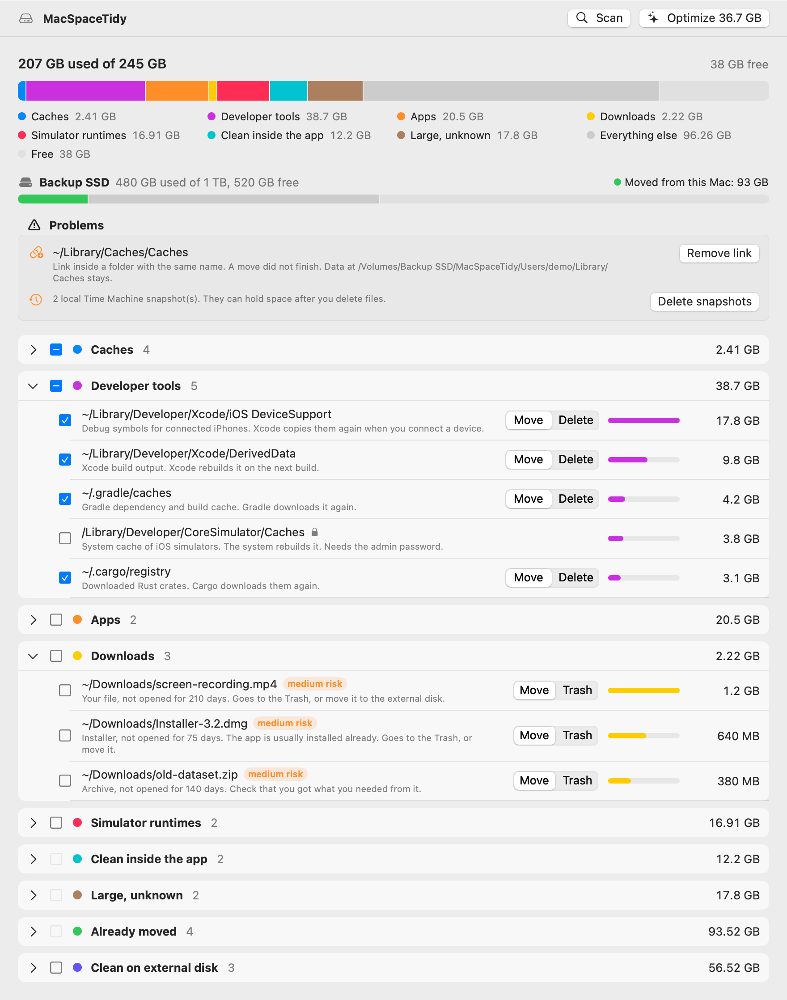
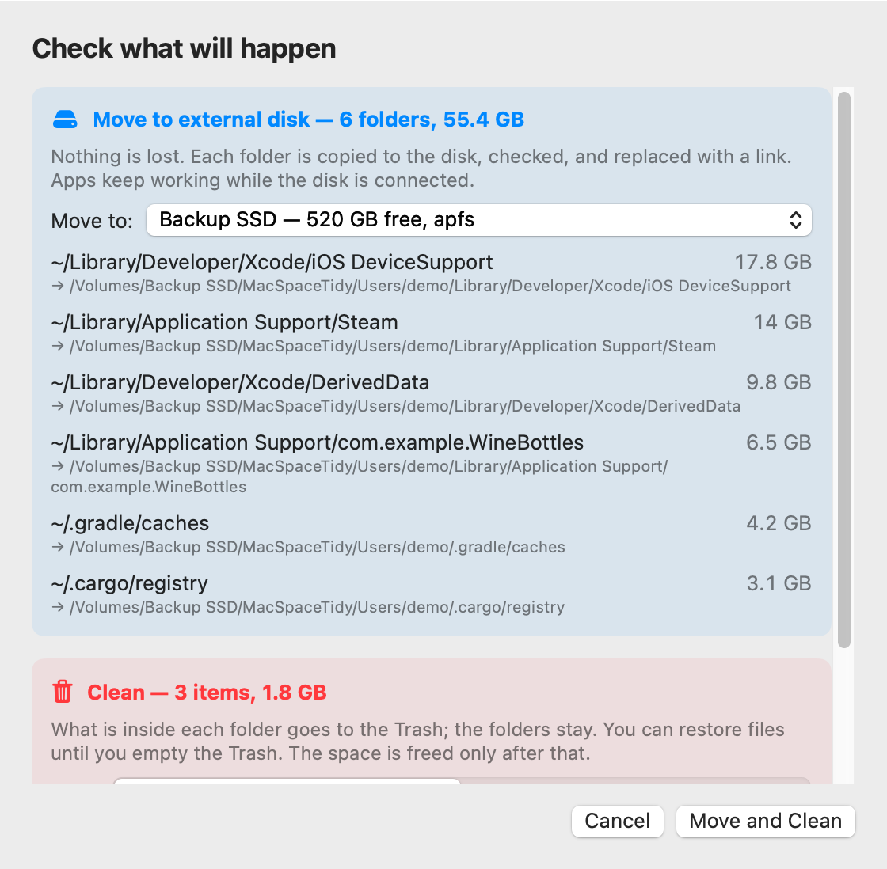

<p align="center"></p>

# MacSpaceTidy

**Live with the smallest Mac storage — without deleting what you need.**

MacSpaceTidy shows what fills your Mac's disk, cleans caches that rebuild themselves, and moves big
folders to a fast external SSD behind a link. Apps keep working. Your home folder and macOS stay on the
internal disk. One scan, one button.

It comes as a Mac app and as a full-screen terminal program. Both are free and open source.

<p align="center">
  <picture>
    <source media="(prefers-color-scheme: dark)" srcset="docs/images/screenshot-dark.png">
    
  </picture>
</p>
<p align="center"><sub>Demo data. The window with real data looks the same.</sub></p>

---

## Why I built it

I use a Mac mini with the smallest internal storage. It is a great machine, but the disk is always full.

Developer work fills it fast. In one cleanup session on my Mac I found:

- 38 GB of Python packages in the `uv` cache,
- 18 GB of iPhone debug symbols from Xcode,
- 14 GB of npm packages,
- 17 GB of iOS simulator runtimes,
- 20+ GB of app data from editors and AI tools.

One day the Mac restarted by itself. The disk was so full that macOS ran out of room for swap.

### The options I looked at

| Option | Why it did not work for me |
|---|---|
| Buy more storage | Apple charges a lot for it, and you choose once, when you buy the Mac. |
| Put a bigger SSD inside | Third-party upgrades exist, but Apple does not support them, and you risk the warranty. |
| Move the whole home folder to an external disk (System Settings → Users & Groups → Advanced Options) | It works for some people. For me it felt risky and not stable: if the disk is not ready at login, your account breaks. |
| A cleaner app | It deletes caches, and they come back next week. None of them moves big folders safely. |

### My way

Keep macOS and the home folder on the internal disk. Move only the **big folders** to a fast external SSD
and leave a link in their place, so apps still find them. Clean the **caches** that rebuild themselves.
Check every step.

I did this by hand for months, with a set of small scripts and a lot of notes about what is safe.
MacSpaceTidy is that toolset, packed into one tool so other people with a small disk can use it too.

Other ways may suit you better. This tool is about my way.

---

## What it does

- **Shows the space.** A bar of your disk split into categories: caches, developer tools, apps, simulators,
  things to clean inside apps, big unknown folders. Real numbers from the disk, not guesses.
- **Finds problems.** Links to an external disk that is not connected, broken links, links left over from a
  move that did not finish, Time Machine snapshots that hold space, low free space.
- **Cleans safely.** Caches are emptied, not deleted: the folder stays, so links and permissions stay too.
  You choose: to the Trash (you can restore) or delete now. It knows about 110 cache and toolchain locations
  (Xcode, simulators, Node, Python, Rust, Go, JVM, Flutter, editors, AI tools). A cache of an app you used in the
  last two days is not checked by default: the app may be using it.
- **Tidies Downloads.** Old installers, archives, and files you have not opened for months, one by one.
  They are never checked for you and always go to the Trash. Or move them to the external disk.
- **Finds leftovers of removed apps.** Data in `~/Library` that belongs to no installed app, and a Wine prefix when
  Wine is gone. Never checked for you, and always goes to the Trash.
- **Moves big folders.** To your external SSD, behind a link. Big developer caches can be moved or deleted —
  moving is the default when a disk is set.
- **Moves them back.** One button per moved folder.
- **Looks after the external disk too.** Shows how much you moved there, when each folder last changed,
  and which moved caches and old copies you can clean.

<p align="center"></p>

### Safety rules

- The scan only reads. Nothing changes until you press the button and confirm the list.
- A move copies first, checks the copy file by file, swaps in a link, checks the link, and only then
  deletes the old folder. If any step fails, everything goes back as it was.
- It never touches settings, passwords, iCloud, mail, or macOS itself. It moves only folders inside your
  home folder and `/Users/Shared`.
- It refuses disks that cannot keep file permissions (exFAT, FAT).
- Freed space is measured on the disk before and after, not estimated.
- Every move is written to a journal in `~/Library/Application Support/MacSpaceTidy/`.

### What to know before you move

- A moved folder works only while the external disk is connected. Use a disk that stays plugged in.
- Some apps delete and recreate their cache folder, which removes the link. That is why small app caches
  are only cleaned, never moved.
- The app is not notarized by Apple (no paid developer account), so macOS shows a warning when you download it
  with a browser. The [Install](#install) section explains how to open it safely.

---

## Install

Needs macOS 14 Sonoma or newer. Works on Apple silicon and Intel Macs.
### Easiest: one command

Open **Terminal** (press Cmd-Space, type `Terminal`, press Enter), paste this line, press Enter:

```bash
/bin/bash -c "$(curl -fsSL https://raw.githubusercontent.com/yanmasharski/MacSpaceTidy/main/install.sh)"
```

It downloads the latest release, checks it, puts `MacSpaceTidy.app` in Applications, and opens it.
No warning from macOS, because a file downloaded this way is not marked as "from the internet".
You can read the script first: [install.sh](install.sh). Run it again any time to update.

### Download by hand

1. Download `MacSpaceTidy.zip` from [Releases](../../releases) and unzip it.
2. Move `MacSpaceTidy.app` to Applications.
3. Open it. macOS will most likely refuse, see the next section.

### macOS says the app is "damaged", "unsigned", or "from an unidentified developer"

This is normal for apps outside the App Store that are not notarized by Apple. Notarization needs a paid
Apple Developer account ($99 a year). MacSpaceTidy is free and open source, so it does not have one yet.
The app is signed in the "ad hoc" way: it is not changed after the build, but Apple has not checked it.
Browsers mark every download as "from the internet", and macOS blocks such apps at the first launch.
The message may say the app is damaged and should be moved to the Trash. **Do not delete it. It is not damaged.**

Pick one way:

1. **The one command above.** It also fixes an app you already downloaded: it replaces it with a clean copy.
2. **Allow it in System Settings** (macOS 15 and newer):
   1. Try to open the app once. Click **Done** (not "Move to Trash").
   2. Open System Settings → **Privacy & Security**, scroll down to **Security**.
   3. Click **Open Anyway** next to "MacSpaceTidy was blocked", then confirm with your password.
   On macOS 14 you can also right-click the app → **Open** → **Open**.
3. **Remove the mark in Terminal** (if the app is in Applications):

   ```bash
   xattr -dr com.apple.quarantine /Applications/MacSpaceTidy.app
   ```

If you do not trust a program from the internet, build it yourself from the source: see below.

### After the first launch

For full numbers, give the app **Full Disk Access**: System Settings → Privacy & Security → Full Disk Access.
The app works without it, but some folders stay unmeasured.

### Build from source

Needs the Xcode command line tools (`xcode-select --install`).

```bash
./scripts/build-app.sh
open build/MacSpaceTidy.app
```

Terminal program:

```bash
swift build -c release
.build/release/mac-space-tidy
```

---

## Terminal program

`mac-space-tidy` with no arguments opens the same screen as the app, in the terminal:

| Key | Action |
|---|---|
| ↑ ↓ | Move |
| Space | Check or uncheck an item or a whole category |
| Enter | Open or close a category |
| m | Switch a big cache between Move and Delete, or move any big item by hand |
| b | Move a moved folder back |
| x | Fix the selected problem |
| d | Choose the external disk |
| s | Scan again |
| o | Optimize: shows the full list first, Enter runs it |
| q | Quit |

A plain read-only report for scripts:

```bash
mac-space-tidy scan              # biggest items per category
mac-space-tidy scan --all        # every item
mac-space-tidy scan --moved-sizes  # also measure folders on external disks (slow)
```

---

## For developers

```bash
swift test
./scripts/package-release.sh   # builds dist/MacSpaceTidy.zip and its .sha256 file for a release
```

A move to a real external disk and back (off by default, uses a small temp folder):

```bash
MST_REAL_DISK=/Volumes/<disk> swift test --filter RealDiskTests
```

The rules about what is safe live in one file: [`catalog.json`](Sources/MacSpaceTidyCore/Resources/catalog.json).
Design decisions: [docs/design.md](docs/design.md).

## Related projects

- **[SpaceGuard](https://github.com/mkrn/spaceguard)** by [mkrn](https://github.com/mkrn). A menu-bar app that watches
  your free space and cleans stale developer caches, simulator runtimes, and git worktrees left by coding agents
  (Claude Code, Codex, Cursor). It only deletes; MacSpaceTidy also moves folders to an external disk.
  If you need to clean worktrees, or want a watcher in the menu bar, look at SpaceGuard.

## Thanks

- [mkrn](https://github.com/mkrn) and SpaceGuard (MIT) gave me ideas that I took into MacSpaceTidy: reading folders
  with `getattrlistbulk` for fast size counts, a screenshot mode for the README, a longer list of known cache
  locations, not checking caches that were used in the last days, and a retry for read-only trees such as the Go
  module cache. The code here is written separately.

## License

[MIT](LICENSE).

## Status

Early. I use it on my own Mac mini. Bug reports and catalog additions are welcome.
